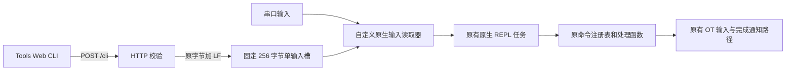
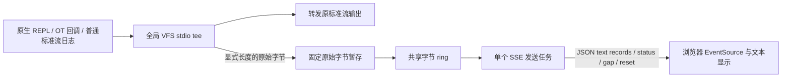

# WebUI 与 Web CLI

项目使用 ESP HTTP Server、SPIFFS 静态页面和原生 JavaScript。在 **Management → Tools** 的 Web CLI 中，可以读取共享控制台输出并提交与串口相同的命令。

## 使用与限制

启用 `CONFIG_OPENTHREAD_BR_START_WEB=y`，在 `idf.py menuconfig` → `ESP Thread Border Router Example` 中开启 Web CLI。输入还需要 `CONFIG_OPENTHREAD_CLI=y`。Web CLI 默认关闭；相关配置如下：

```ini
CONFIG_OPENTHREAD_BR_START_WEB=y
CONFIG_OPENTHREAD_CLI=y
CONFIG_ESP_BR_WEB_CLI=y
CONFIG_ESP_BR_WEB_CLI_BUFFER_SIZE=16384
CONFIG_VFS_MAX_COUNT=10
```

标准 USB 控制台、RCP UART 和双 SPIFFS 配置启用 Web CLI 后共需 9 个 VFS 注册项，示例预算设为 10。旧的 `CONFIG_VFS_MAX_COUNT=8` 会在 RCP UART 注册时返回 `ESP_ERR_NO_MEM`；构建检查会拒绝 Web CLI 开启但预算低于 9 的配置。这是 VFS 注册项数量，不是打开文件数或 eventfd 数量。

已有配置请通过 menuconfig 调整；defaults 不覆盖已有值。重新编译后，同时刷入应用和 `web_storage` 分区，再刷新 `/tools.html`；仅更新应用的 OTA 不会更新 SPIFFS 页面。

输入例如 `ot state`、`ot wifi ...` 或 `help`。网页和 HTTP 后端不增删 `ot` 前缀，也不裁剪首尾空格；输入仍经过 SDK 原生控制台编辑和清理规则，不保证每个字节都成为命令参数。

**不要同时使用串口和 Web 输入，也不要从尚未提交的串口草稿、Tab 补全或仍在执行／等待完成通知的命令切换输入来源。** 这不是带输入仲裁的多终端服务。串口和 Web 固定使用 **80 列**；SDK 探测选择的完整／基础编辑模式保持不变，不强制基础模式。

按 Enter 发送，↑／↓ 浏览最近 50 条已接受的命令。有效提交立即清空输入框并显示 `Sending command...`；HTTP 202 仅表示输入被接受，不代表开始执行、执行成功或完成。结果显示在共享输出区。提交处理不向输出区追加命令或提示符，只负责请求、状态和本地历史；原生 REPL 的命令回显仅通过 SSE 作为设备输出显示。

所有经捕获标准流的日志和控制台输出都是同一来源，没有 BR LOG 筛选开关。保留日志级别颜色、Auto-scroll、Pause、Copy All 和 Clear。Copy All 复制整个当前输出区，不限于可见滚动范围；复制反馈只出现在状态栏。Clear 仅清除页面显示，不删除设备缓存、不重置续传游标。丢失／重启通知沿用单独一行的方括号提示，与设备文字区分。

Send 不因 SSE 断开、重连或暂停而禁用。提交反馈与输入错误显示在状态栏，普通输出不覆盖反馈。前端允许继续提交；如果设备单个输入槽仍有未读数据，返回 503。请求超时无法确定输入是否已经接受，不自动重发；先检查输出再决定是否重试。

Thread 为 disabled／detached 时仍可操作 CLI，Ping 单独依网络状态禁用。改变 Wi-Fi、重启或恢复出厂设置可能导致页面断线。现有 HTTP 服务没有认证或 TLS；能访问管理地址的客户端可以读取输出并提交具有设备权限的命令，只应在受信任的管理网络使用。

## 输入：只使用原有原生控制台任务



HTTP 接受一条 **1–255 个 UTF-8 字节**的单行命令，拒绝控制字符、无效 JSON／内容类型和过大请求。校验后只将命令字节和一个 LF 复制到固定 256 字节槽；槽满或输入／捕获未就绪时返回 503，成功返回 **空正文 202**。

槽在读取器消费最后的 LF 时释放，而不是在命令完成时释放。因此容量不等于执行状态；202 不是执行忙闲判断，也不保证命令已完成。没有新建 Web 命令执行任务，没有 `esp_console_run` 包装、命令互斥锁或 busy 状态。原生 REPL 仍是唯一调用 `esp_console_run()` 的任务，SDK 原来的参数解析、原生编辑、OT 投递和完成通知保持原路径；不合成输入记录或额外错误记录。

初始化顺序是：构造原生控制台并完成 SDK 探测，再安装自定义输入读取器，最后启动原有 REPL 任务。读取器用 `select()` 等待物理 stdin 或 Web eventfd，空闲不轮询；Web 字节仅注入 linenoise 读回调，命令内部的 `getchar()` 仍读取物理 stdin。运行期宽度查询 `ESC[6n` 被抑制／失败后使用原生 80 列回退，不实现完整 CPR／转义解析器，也没有按键定时层。初始化后的读取器和标准流捕获按固件生命周期保留，不支持运行时停止／卸载。

## 输出：标准流原始字节 tee



全局 VFS stdio tee 转发原输出，并按明确长度复制原始字节到 ring。它不调用 `esp_log_set_vprintf`，不为每条命令切换 FILE 包装，也不重复接管 OT 输出回调。普通 stdout 日志与控制台输出同样采集，来源始终是 `cli`。

捕获过程不解析 UTF-8、不把 NUL 当结束符、不格式化或截断输出。固定 pending 缓冲只是合并小字节写入，满时分片入 ring；记录边界不等于字符或行边界。超出历史容量时丢弃最旧完整记录，不等待浏览器；这是历史覆盖，不是按字符串截断。

`CONFIG_ESP_BR_WEB_CLI_BUFFER_SIZE` 是预分配字节 ring 的大小，范围 1–64 KiB，默认 16 KiB；另有少量管理状态。每条记录保存 12 字节头（序号、字节长度、来源、保留字节）和实际原始字节，没有结构体对齐填充或字符串结束符。旧 `CONFIG_ESP_BR_WEB_CLI_RECORD_COUNT` 不再使用，迁移时应明确配置字节预算，不能把记录数直接当字节数。

关闭 `CONFIG_ESP_BR_WEB_CLI` 后，不启用捕获、输入适配或设备端 ring，`/cli` 和 `/cli/events` 不注册。页面从 `/web/features` 读取 `web_cli` 编译功能标志，隐藏功能且不建立 SSE；共享 SPIFFS 仍保留静态 HTML／JS，占用 Flash。

## HTTP 与 SSE 合约

完整接口见 [OpenAPI](<../components/esp_ot_br_server/src/openapi.yaml>)。页面及接收实现分别位于 [Tools](<../components/esp_ot_br_server/frontend/tools.html>) 和 [web-cli.js](<../components/esp_ot_br_server/frontend/static/web-cli.js>)。

| 接口 | 行为 |
|---|---|
| `POST /cli`，JSON `{"command":"ot state"}` | 单条 1–255 字节输入；空正文 202 仅确认接受；503 表示输入槽满或捕获／输入不可用，不表示执行 busy |
| `GET /cli/events` | 单个 SSE 订阅，初始状态后读取保留输出；不消费 ring |
| `GET /cli/events?after=SESSION:SEQ` | 按游标续读；原生重连的 `Last-Event-ID` 优先于 `after` |

每个事件都有 `id: SESSION:SEQ`，JSON 根字段是十进制字符串 `session`、`cursor` 和布尔值 `ready`。`ready` 表示**输出捕获和输入设置均已就绪**，不表示输入槽空闲，也不表示没有命令正在执行。

- `records`：最多 16 条记录，格式为 `{seq: 十进制字符串, source: "cli", text: JSON字符串}`；`cursor` 是本批最后一条序号，不提供 `log`／`input` 来源。
- `status`：连接建立或 ready 变化时发送；只有根元数据。
- `gap`：未读历史已覆盖；只有根元数据，游标定位到当前最旧记录之前。
- `reset`：启动标识变化或游标超前；只有根元数据，同样重新定位。

```text
event: records
id: 12345:102
data: {"session":"12345","cursor":"102","ready":true,"records":[{"seq":"102","source":"cli","text":"leader\r\n"}]}

```

上例文本是 `leader\r\n`。序号始终用字符串处理，避免 JavaScript 的 64 位整数精度损失。浏览器由 EventSource 处理 UTF-8，再用 `JSON.parse` 解析，校验完整事件的元数据、序号格式、来源和 `text` 字符串后才提交游标并追加记录，不另设字节解码层。

采集和 ring 仍保留原始字节；仅 SSE 发送阶段按明确长度准备显示文本：忽略 NUL，但保留其后的输出；最多暂留 3 个不完整 UTF-8 尾字节，与下一片段衔接。续传查找游标时，用仍保留的跳过记录重建尾字节状态，不重复发送旧文本；历史已覆盖时无法恢复丢失的字符前缀。这不是完整 Unicode 校验器，也不是任意二进制传输。JSON 序列化负责转义引号、反斜杠和控制字符，换行不会破坏 SSE 事件边界。

输出区是文本日志视图，不是完整终端模拟器。前端先合并 SSE 文本片段，再处理当前行的回车覆盖、退格、水平光标移动和清行，使原生控制台重绘覆盖旧内容，而不是追加重复文字；跨事件拆分的控制序列在拼接后处理。其它终端控制仍忽略，不模拟多行光标移动。显示通过 `textContent` 并保留日志颜色；设备文字不作为 HTML 执行。状态和提交反馈显示在状态栏；丢失通知以方括号单独显示。

## 资源与连接边界

只允许一个 SSE 订阅，第二个返回 503。发送端使用固定连接上下文、HTTP 异步请求和一个 4096 字节栈的 SSE 任务，不是命令执行任务；无订阅时没有该任务。除 ring 外，还有任务控制块、请求副本、TCP 缓冲、JSON／事件临时分配；实际内存峰值需上板测量。

每轮最多处理 16 个片段，约每 50 ms 检查输出并让出 CPU；每 10 秒发送 SSE 注释心跳，建议重连间隔 3000 ms。每个完整事件通过一次 HTTP chunk 提交，TCP 仍可能分包；浏览器仅处理完整事件。读取短暂加锁复制记录，JSON 序列化和网络发送在锁外；慢订阅不阻塞生产者或普通 HTTP 请求。发送失败释放订阅及发送任务，CLOSED EventSource 等待 3 秒后重建。

页面最多保留 800 个显示片段，渲染合并到下一帧。暂停、隐藏或离开页面会关闭订阅；恢复携带最后完整校验的事件 ID。暂断由 EventSource 自动续传，手动重建使用 `after`。缓存之外的历史只能报告 gap，不能恢复；断开 SSE 不会取消已接受的输入，也不自动重发命令。

不保存历史到 Flash，不包含捕获初始化前的输出，也不保证捕获绕过 VFS 标准流的 ROM／early log、panic 或直接硬件输出。日志级别仍受固件配置控制。较小 ring、输出过快或长时间暂停都可能丢失较早记录；SSE 不消除 Wi-Fi 省电、丢包或 TCP 重传延迟。
